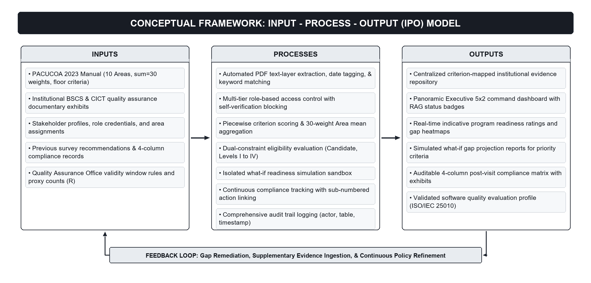
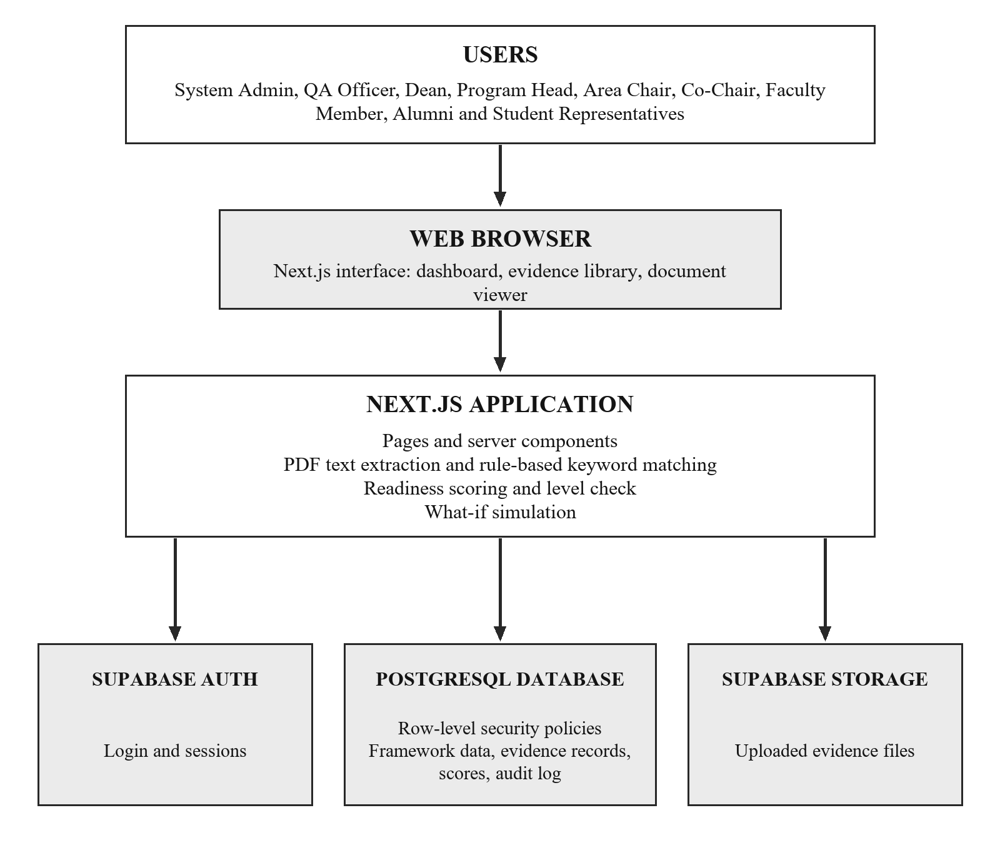
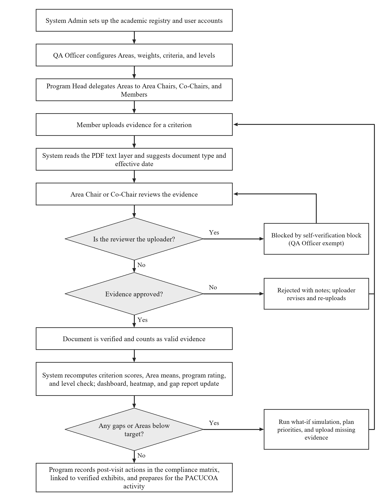

# WEB-BASED ACCREDITATION MANAGEMENT AND READINESS ASSESSMENT SYSTEM
### Capstone Book, Chapters I to III (Draft for Adviser Review)

---

## CHAPTER I
## INTRODUCTION

### Background of the Study
Accreditation is one of the main ways in which a higher education institution (HEI) in the Philippines shows that its programs meet an external standard of quality. Participation in accreditation is voluntary and is initiated by the private sector. Conchada and Tiongco (2015) note that this arrangement protects academic freedom and encourages institutions to compete, but that it can also breed complacency in others. They suggest that institutions build an accreditation mechanism, such as a quality assurance framework, into their own operating systems. This study takes that suggestion as its starting point: accreditation readiness is better managed as a continuous institutional activity than assembled hurriedly when an external survey visit is announced.

The Philippine Association of Colleges and Universities Commission on Accreditation (PACUCOA) is one of the private-sector accrediting agencies and is listed on the cover of its Manual as an affiliate member of the Federation of Accrediting Agencies of the Philippines (FAAP). Its Manual of Accreditation (PACUCOA, 2023) sets out the process a program follows: an application, an institutional self-survey, and the organization of the accrediting team. It then describes the visits that follow: an orientation visit, a preliminary visit, a Level I formal accreditation visit, and reaccreditation visits for Levels II, III, and IV. The self-survey is therefore not a preliminary formality. It is the school's own structured assessment, and it comes before every external visit.

The Manual also fixes how the self-survey is scored. Each Area is rated by the self-survey team and the accreditors on a scale of 0 (missing but necessary) to 5 (excellent), with a "not applicable" option where a provision does not apply. The mean rating of each section is multiplied by the section's weight. The weighted values are summed and divided by the total weight, which is 30 for basic education and undergraduate programs, to obtain the final rating (PACUCOA, 2023). 

For undergraduate programs the ten Areas are:
1. Area I: Philosophy and Objectives (Weight: 3)
2. Area II: Faculty (Weight: 3)
3. Area III: Instruction (Weight: 4)
4. Area IV: Laboratory (Weight: 3)
5. Area V: Research (Weight: 3)
6. Area VI: Library (Weight: 3)
7. Area VII: Student Services (Weight: 3)
8. Area VIII: Social Orientation and Community Involvement (Weight: 3)
9. Area IX: Physical Plant and Facilities (Weight: 2)
10. Area X: Organization and Administration (Weight: 3)

Instruction carries a weight of 4, Physical Plant and Facilities a weight of 2, and every other Area a weight of 3. The Manual further sets minimum ratings for each status: a general average of at least 3.00 for Candidate status; at least 3.00 with no section below 3.00 for Level I; at least 3.50 with no section below 3.50 for Level II; and at least 4.00 with no criterion below 4.00 for Levels III and IV (PACUCOA, 2023). A program can therefore fail to reach a level even when its overall average is high, because one weak Area is enough to hold it back.

Meeting these ratings requires a large body of documentary evidence. For each of the ten Areas, the Manual lists suggested exhibits. Examples are faculty records and transcripts, recruitment and ranking policies, course syllabi, research outputs, library holdings, student services records, site and building plans, organizational charts, and minutes of meetings (PACUCOA, 2023). These documents come from many offices and many people. 

The Manual's policies are also time-bound. A compliance report for a revisit is due at least 30 days before the visit, and an accredited program must be visited by a resurvey team at least six months before its status expires, or the status lapses and the program reverts to Candidate status unless a grace period is granted (PACUCOA, 2023). These deadlines leave little room to discover missing evidence late.

In institutions that compile exhibits manually, this workload is usually carried through physical folders, shared drives, and email. Vendors of accreditation software describe the same pattern of scattered folders and email chains as the situation their products are meant to replace (Watermark Insights, n.d.-b). At STI West Negros University, shared Google Drive folders are used to keep accreditation evidence. [Insert findings from the QA office and CICT Chair interviews describing how STI West Negros University currently prepares, reviews, and stores accreditation evidence, and any problems this causes.]

---

### Background of the Institution
STI West Negros University (STI WNU) is a private university in Bacolod City, Negros Occidental. According to the university, it began as West Negros College, founded on Valentine's Day in 1948 by three Baptist women leaders, Luciana Aritao, Teresa Padilla, and Rosario Remetio, shortly after the Second World War (STI West Negros University, n.d.). The college was first housed in a rented hall and moved to its Burgos Street campus in 1951 as enrollment grew (Visayan Daily Star, n.d.).

In 2013, STI Education Systems Holdings, Inc. executed a deed of absolute sale for more than 99 percent of the outstanding shares of West Negros University Corp. STI Holdings said the purchase would widen its network of institutions and course offerings at the tertiary level and give it entry into basic education and graduate studies (Philippine Daily Inquirer, 2013b). The university has since operated as STI West Negros University. Before the acquisition, the university had eight colleges offering 28 associate and bachelor's degree programs, together with a School of Graduate Studies offering master's and doctoral programs. It was reported to be accredited by PACUCOA for several of its colleges (Philippine Daily Inquirer, 2013a).

Today the university awards associate, bachelor's, master's, and doctoral degrees. It describes itself as a second level-accredited school under PACUCOA, with about 14,000 students per semester and about 1,500 graduates each school year (STI West Negros University, n.d.). Its campus lies on Burgos Street in central Bacolod City (Philippine Daily Inquirer, 2013b).

The College of Information and Communications Technology (CICT) offers the Bachelor of Science in Information Technology (BSIT) and the Bachelor of Science in Computer Science (BSCS). The BSCS program is the pilot program of this study. BSIT is configured in the system but is not populated with evidence or evaluated in this study. According to the department, BSCS currently holds Level I accredited status, while BSIT holds Level II reaccredited status under PACUCOA. [State the official accreditation status of BSCS and BSIT, and the date of the next scheduled survey activity, as confirmed by the QA office.] Because CICT offers computing programs, it is well placed to serve as the pioneer department to adopt a web-based system for managing its own accreditation evidence and readiness assessments.

---

### The Proposed System
This study proposes the Web-Based Accreditation Management and Readiness Assessment System. It moves the paper-based and shared-drive exhibit and readiness process to a single web platform, so that evidence is kept, verified, and scored digitally. 

The system is designed around the PACUCOA undergraduate framework:
1. It organizes evidence under PACUCOA's ten Areas and criteria, and it lets the Program Head delegate each Area to an Area Chair, an optional Co-Chair, and Members.
2. It requires that evidence be verified by someone other than the person who uploaded it (the self-verification block). The QA Officer, as final institutional authority, is exempt so reviews are not stalled, and QA verifications are recorded in the audit log.
3. It computes an indicative readiness rating using the Manual's weighting formula (total weight of 30) and checks it against the Manual's level thresholds.
4. It visualizes the ten Areas in a unified 5-column by 2-row (5×2) executive command dashboard, accompanied by an instant criteria drill-down inspector and a color-coded heatmap.
5. It lets administrators simulate how completing up to ten selected unresolved criteria (applying a fixed assumed completion score of 4.00) would change the program rating and level, without altering recorded readiness data.
6. It tracks post-visit opportunities and recommendations using a 4-column compliance matrix modeled on the format of the CICT BSCS Compliance Report (College of Information and Communications Technology, n.d.), with the columns Opportunity for Improvement, PACUCOA Recommendation, Actions Taken (with sub-numbered items), and Team Verification (with linked evidence exhibits that can be opened in an inline document viewer).

The structure of the framework (Areas, weights, criteria, and levels) is stored as configurable data rather than hardcoded in the application. Neither the rating scale nor the weights are changed from those in the Manual.

---

### Objective of the Study

#### General Objective
This study aims to design, develop, and evaluate a Web-Based Accreditation Management and Readiness Assessment System aligned with the PACUCOA Manual of Accreditation (2023), using the College of Information and Communications Technology (CICT) of STI West Negros University—specifically its BSCS program—as the pilot site.

#### Specific Objectives
1. To develop an Evidence Management and Mapping module that stores accreditation evidence under PACUCOA Areas and criteria, suggests a document type and effective date from the text layer of uploaded PDF files, supports delegation of Areas to Area Chairs, Co-Chairs, and Members, and enforces separation of duties through a self-verification block.
2. To develop a Readiness Scoring and Executive Dashboard module that computes ratings at the criterion, Area, and program levels using the PACUCOA weighting formula, compares the result with the Manual's level thresholds, and presents the results through an executive 5×2 10-Area dashboard, a criteria drill-down inspector, a color-coded heatmap, and a gap report.
3. To develop a Readiness Simulation module that projects the program rating and level that would result if up to ten selected unresolved criteria were completed (using a fixed assumed completion score of 4.00), without mutating recorded readiness scores.
4. To develop a Post-Visit Compliance Tracking module that records survey opportunities for improvement, accreditor recommendations, sub-numbered actions taken, and team verifications linked directly to verified evidence exhibits.
5. To evaluate the quality of the system using the software quality characteristics of ISO/IEC 25010 with respondents from CICT and IT experts.

---

### Conceptual Framework
The study follows an Input–Process–Output (IPO) model with a feedback loop, as outlined in Figure 1.

*Figure 1. Conceptual Framework of the Study (Input–Process–Output Model with Feedback Loop).*

#### Narrative of the Conceptual Framework
- **Inputs**: The inputs consist of the PACUCOA undergraduate framework data (the ten Areas, their weights totaling 30, criteria definitions, required document counts, and minimum rating thresholds); user accounts and role scopes; institutional evidence documents uploaded by faculty members; and post-visit survey recommendations.
- **Processes**: The core processes comprise criteria mapping and rule-based keyword extraction on PDF text layers; Area delegation and independent verification governed by the self-verification block; mathematical computation of criterion scores, Area means, and weighted grand means; evaluation against dual-constraint level floors; what-if simulation calculation in memory; tracking of sub-numbered post-visit actions linked to exhibits; and recording of completed administrative actions in the audit log.
- **Outputs**: The outputs are the executive 5×2 10-Area dashboard, the criteria drill-down inspector, the color-coded heatmap, the gap report, the projected simulation results, the compliance report with linked exhibits, the audit trail, and the empirical ISO/IEC 25010 evaluation results.
- **Feedback Loop**: When gap reports identify unfulfilled criteria or when evidence is rejected with reviewer notes, faculty members upload revised or supplementary evidence. This returns new inputs into the system, ensuring that readiness is continuously tracked and refined rather than reconstructed before a survey visit.

---

### Significance of the Study
The results of this study may benefit the following groups:

- **STI West Negros University**: The institution gains a centralized web platform to organize accreditation evidence and monitor readiness continuously. This supports its PACUCOA accreditation efforts and reduces the last-minute preparation rush.
- **Quality Assurance (QA) Office**: The QA office gains a university-wide overview of program readiness, maintains framework parameters, and conducts supervisory reviews.
- **College Dean and Program Heads**: The Dean can review programs within the college. Program Heads can identify weak Areas, assign committee responsibilities, track verified evidence, and use simulations to prioritize outstanding tasks.
- **Area Chairs, Co-Chairs, and Faculty Members**: Faculty members know exactly which criteria and documents are assigned to them, can inspect uploaded files directly via the integrated document viewer, and receive prompt feedback on approvals or rejections.
- **Alumni and Student Representatives**: Stakeholders can view a high-level readiness summary of their program, supporting transparency in quality assurance.
- **Future Researchers**: The study provides a documented, PACUCOA-aligned system design, mathematical scoring model, and evaluation dataset that other researchers may build upon.

---

### Scope and Limitation of the Study

#### Scope of the Study
The study covers the design, development, and evaluation of a web-based system for the PACUCOA self-survey and readiness-preparation phase. 

The system is limited to the PACUCOA framework following the Manual of Accreditation (Rev. September 2023):
- The ten Areas of undergraduate programs and their weights (total weight: 30).
- The 0-to-5 rating scale and the weighted-average rating formula.
- The minimum rating thresholds and floor rules for Candidate status, Level I, Level II, and indicative Level III and IV.
- The pilot covers the Bachelor of Science in Computer Science (BSCS) program of CICT at STI West Negros University. The BSIT program is configured in the system but is not populated with evidence or evaluated in this study.
- The system includes four functional modules: Evidence Management and Mapping, Readiness Scoring and Executive Dashboard, Readiness Simulation, and Post-Visit Compliance Tracking.
- The system supports seven base roles (System Admin, QA Officer, Dean, Program Head, Faculty Member, Alumni Representative, and Student Representative) and three Area assignment types (Area Chair, Co-Chair, and Member).
- An audit trail logs completed evaluative and administrative actions. Areas, criteria, weights, and levels are stored as configurable database entities.

#### Limitations of the Study
1. **Indicative Readiness Estimates**: The system supports, and does not replace, PACUCOA's official accreditation process. The application, accrediting team organization, on-site visits, and official status awards remain with PACUCOA (PACUCOA, 2023). System ratings are indicative estimates of documentary sufficiency; they do not represent the qualitative judgment of external accreditors and do not guarantee an accreditation outcome.
2. **Criteria Subset in Pilot Prototype**: The pilot system implements a representative set of 22 criteria across the ten Areas. The full PACUCOA undergraduate survey instrument contains a more extensive set of criteria and sub-items, which can be configured into the database as the institution expands its use.
3. **Program Level Restrictions**: The scoring engine implements the undergraduate 10-Area framework (weight total: 30). The structures for graduate programs (weight total: 50), technical-vocational programs, and basic education units are not modeled.
4. **Supplementary Criteria and Licensure Performance**: The supplementary qualitative criteria for Levels III and IV (such as community outreach visibility and research tradition) and PRC licensure examination passing percentages are outside the scope of this system, as computing degree programs (BSCS and BSIT) do not have professional board examinations.
5. **Text-Layer PDF Parsing**: Automated document classification and date suggestions rely on rule-based keyword matching executed on digital PDF text layers. Scanned or image-only PDFs without readable text cannot be automatically classified and must be tagged manually, as the system does not include Optical Character Recognition (OCR).
6. **Document Versioning**: Each upload is stored as an individual record with its effective date and review status; explicit linking of replacement documents in a version chain is not implemented.
7. **No External SIS/LMS Integration**: The system operates independently and does not interface with the university's student information system or learning management system.
8. **Audit Trail Scope**: Blocked self-verification attempts are rejected at the database level by Row-Level Security before application-level logging executes; consequently, the audit log records completed transactions rather than rejected attempts.
9. **Timeframe and Evaluation Setting**: Development and data gathering are carried out within a three-month period (August to October 2026), which limits the number of development iterations and the duration of the evaluation. The evaluation is limited to respondents from CICT and selected IT experts at STI West Negros University.

---

### Definition of Terms
- **Accreditation**: A voluntary, standards-based process by which an authorized accrediting agency evaluates and recognizes the quality of an educational institution or program.
- **PACUCOA**: The Philippine Association of Colleges and Universities Commission on Accreditation, the accrediting body whose framework this study implements.
- **Manual of Accreditation**: The official regulatory document (Revised September 2023) published by PACUCOA that establishes accreditation procedures, the 0–5 rating scale, Area weights, status thresholds, and suggested exhibits.
- **Self-Survey**: An internal evaluation conducted by the school assessing its academic program against the Areas and criteria of the survey instrument prior to an external visit.
- **Area**: One of the ten major evaluative divisions of the PACUCOA undergraduate survey (e.g., Faculty, Instruction, Laboratories), each carrying an assigned mathematical weight.
- **Criterion**: An evaluative item within an Area against which evidence is uploaded and scored.
- **Evidence (Exhibit)**: A document, syllabus, report, or certification uploaded to demonstrate compliance with a criterion.
- **Evidence Mapping**: The association of an uploaded file with its corresponding PACUCOA Area and criterion.
- **Verification**: The formal review of an uploaded exhibit by an authorized user, resulting in approval or rejection with reviewer notes.
- **Separation of Duties (Self-Verification Block)**: The rule prohibiting a user from verifying a document that they personally uploaded. The QA Officer is exempt as the final authority, and QA verifications are recorded in the audit trail.
- **Criterion Score**: A computed value from 0.00 to 5.00 expressing the ratio of valid, verified documents (V) to required documents (R).
- **Area Mean**: The arithmetic average of criterion scores within an Area.
- **Program Rating**: The weighted average of Area means, computed as the sum of (Area Mean × Area Weight) divided by the total weight of 30.
- **Level**: A PACUCOA accreditation status (Candidate, Level I, Level II, Level III, or Level IV).
- **Gap**: A criterion with no verified evidence or with a score below the passing baseline of 3.00.
- **Heatmap**: A color-coded display visualizing scores across Areas and criteria according to PACUCOA thresholds.
- **Readiness Simulation**: A what-if calculation projecting the program rating and level if up to ten selected unresolved criteria were completed (using an assumed score of 4.00), leaving actual readiness records untouched.
- **Post-Visit Compliance Matrix**: A 4-column matrix tracking Opportunities for Improvement, Recommendations, Actions Taken, and Team Verification with linked evidence exhibits.
- **Role-Based Access Control (RBAC)**: Restricting system permissions according to the designated roles of users.
- **Audit Trail**: A chronological record of completed administrative and evaluative actions stored in the database.
- **CICT, BSCS, BSIT**: The College of Information and Communications Technology and its Bachelor of Science in Computer Science and Bachelor of Science in Information Technology programs. BSCS is the pilot program of this study.

---

## CHAPTER II
## RELATED LITERATURE AND PRIOR ARTS SEARCH

### Related Literature

#### Accreditation and Quality Assurance in Philippine Higher Education
Conchada and Tiongco (2015) reviewed the accreditation system for Philippine higher education institutions and its accrediting bodies. They describe an arrangement that is initiated by the private sector and voluntary, noting two related features: the voluntary nature of the system and the diversity of accrediting agencies serving different institutional sectors. They argue that voluntary accreditation protects academic freedom and encourages institutions to compete, but that it may leave other institutions complacent between survey cycles. Their policy recommendation is that an internal accreditation mechanism, such as a continuous quality assurance framework, should be incorporated into the institution itself. Viewed this way, accreditation readiness should not be treated as an episodic project assembled only when an external team visits; institutions benefit from maintaining the ability to show compliance continuously. That ability relies on keeping evidence organized, verified, and scored between visits.

#### The PACUCOA Accreditation Framework
The Manual of Accreditation (PACUCOA, 2023) serves as the primary standard for this study. It defines the preliminary steps (application, institutional self-survey, and team organization) and the sequence of visits: orientation, preliminary, Level I formal, and Level II to IV reaccreditation visits. Under the Manual, the self-survey and the external accreditors' evaluation use the same single-axis 0-to-5 rating scale, running from 5 (provision is very extensive and functioning excellently) down to 0 (provision is missing but necessary), alongside a "not applicable" option where a provision does not apply.

The Manual specifies how ratings are aggregated. The mean rating of each section is multiplied by its assigned weight, and the sum is divided by the total weight of 30 for undergraduate programs. The weights for undergraduate programs are 3 for Philosophy and Objectives, Faculty, Laboratory, Research, Library, Student Services, Social Orientation and Community Involvement, and Organization and Administration; 4 for Instruction; and 2 for Physical Plant and Facilities. 

Minimum rating thresholds then apply: 3.00 for Candidate status; 3.00 with no section below 3.00 for Level I; 3.50 with no section below 3.50 for Level II; and 4.00 with no criterion below 4.00 for Levels III and IV (PACUCOA, 2023). Level II reaccredited status is granted for a duration of five years (PACUCOA, 2023). These rules make two design features essential for any readiness tool: it must compute the weighted rating using the Manual's exact formula, and it must highlight the lowest Area mean as clearly as the general average, because a single deficient Area can block an accreditation level.

The Manual also sets policies that create operational deadlines. A compliance report is required at least 30 days before a revisit. The revisit team evaluates compliance using an assessment scale from full compliance (5) down to non-compliance (1). An accredited program must be resurveyed at least six months before its status expires, or its status lapses and reverts to Candidate status unless a grace period is granted (PACUCOA, 2023). Together, the extensive exhibit requirements and the strict revisit timelines describe a documentation workload that is large, multi-departmental, and time-sensitive.

#### Digital Evidence Management and Continuous Readiness
Vendors of accreditation software describe a similar industry transition from episodic document gathering to continuous readiness. Watermark Insights (n.d.-a) presents its accreditation tools as a method for keeping evidence organized throughout the cycle, centralizing documentation, and preparing self-study reports efficiently. Its product materials describe managing accreditation cycles through a centralized evidence repository and structured templates, in contrast to scattered desktop folders and email threads (Watermark Insights, n.d.-b). While vendor publications are commercial descriptions of product intent, they confirm that centralized evidence repositories and always-accessible readiness tracking represent recognized needs in higher education quality assurance.

#### Decision Support and What-If Analysis
A readiness rating that reflects only the current state leaves an important planning question unanswered: which unresolved requirements should faculty prioritize? Decision support systems literature treats what-if analysis as a standard capability. In what-if analysis, a decision maker adjusts an input assumption and observes the projected effect on the outcome, without altering the underlying production data (Turban et al., 2011). The Readiness Simulation module applies this concept to accreditation: selected unresolved criteria are assumed to achieve a completion score of 4.00, the weighted rating formula is recomputed in memory, and the projected rating and level are displayed alongside the current status.

#### Access Control and Separation of Duties
Because an accreditation platform stores sensitive institutional files and generates ratings relied upon by academic leadership, access control is fundamental to its design. Role-based access control (RBAC) assigns permissions to roles and roles to users, simplifying administration and audits (Sandhu et al., 1996). 

A related integrity principle is separation of duties, which requires that no single person can complete a sensitive evaluation transaction alone (Clark & Wilson, 1987). In this system, that principle is implemented as the self-verification block: a document must be reviewed and approved by an authorized user other than its uploader before it counts toward readiness. Access rules are enforced at the database tier using PostgreSQL Row-Level Security (RLS), ensuring that restrictions hold on every database operation (Supabase, n.d.).

#### Software Quality Evaluation
ISO/IEC 25010 defines a software product quality model comprising eight characteristics: functional suitability, performance efficiency, compatibility, usability, reliability, security, maintainability, and portability (International Organization for Standardization [ISO] & International Electrotechnical Commission [IEC], 2011). The standard provides the framework for the descriptive evaluation instrument described in Chapter III.

---

### Prior Arts Search

#### Scope of the Search
The search examined publicly accessible documentation, system overviews, and product whitepapers for commercial accreditation management software used in higher education, alongside the academic literature cited above. The search was conducted in September and October 2026. Because it relied on publicly available materials, features not publicly detailed by vendors may exist; the comparison below therefore reports what reviewed sources describe and does not claim what products cannot do.

#### Existing Systems
- **Watermark Planning & Self-Study**: Watermark Insights (n.d.-a, n.d.-b) provides a centralized evidence library and customizable self-study templates, primarily oriented toward US accreditation frameworks.
- **AchieveIt**: AchieveIt (n.d.) offers accreditation management software for institutions preparing for surveys and reaccreditation, with evidence collection, requirements tracking, and progress dashboards.
- **Creatrix Campus**: Creatrix Campus (n.d.) features an accreditation module within a wider higher-education ERP. Users track accreditation criteria, assign tasks to faculty, and map outcomes to international frameworks such as ABET, AACSB, and NAAC.

#### Comparative Analysis
Table 1 presents a comparison between the reviewed software platforms and the proposed system developed in this study.

| Feature / Evaluative Dimension | Watermark | AchieveIt | Creatrix Campus | Proposed System |
|---|---|---|---|---|
| Centralized evidence repository | Described | Described | Described | Yes (Supabase Storage mapped to criteria) |
| Accreditor-specific framework or templates | Pre-built templates | Requirements tracking | Templates cloned to standards | PACUCOA Areas, criteria, and weights, stored as editable data |
| Assignment of responsibility | Collaborative workflows | Accountability features | Tasks assigned to faculty | Area Chair, Co-Chair, and Member delegated per Area by Program Head |
| Progress or readiness dashboards | Described | Real-time progress | Reports and dashboards | Yes, with 5×2 command matrix, criteria inspector, and heatmap |
| PACUCOA framework named in reviewed materials | Not stated | Not stated | Not stated | Yes (explicitly modeled) |
| Rating computed with PACUCOA weighting formula (Sum=30) and floor rules | Not stated | Not stated | Not stated | Yes (Area floors for Lev. I/II, criterion floor for Lev. III/IV) |
| What-if readiness simulation | Not stated | Not stated | Not stated | Yes (non-mutating projection with fixed 4.00 assumed score) |
| Enforced verification by someone other than the uploader | Not stated | Not stated | Not stated | Yes (enforced by database policy, with audited QA exemption) |
| Post-visit compliance matrix with linked exhibits | Not stated | Not stated | Not stated | Yes (4-column format with sub-numbered actions and linked exhibits) |
| Integration with SIS or LMS | Not stated | Not stated | Described | No (out of scope) |

*Table 1. Comparison of Reviewed Systems and the Proposed System, Based on Public Materials.*

#### Synthesis and Research Gap
The reviewed systems demonstrate that centralized document repositories, progress dashboards, and task delegation are established capabilities in commercial accreditation software. The reviewed materials, however, did not show software tailored to the PACUCOA framework, its 30-weight undergraduate formula, its dual-constraint level threshold floors, or a what-if simulation tool that leaves underlying readiness data untouched. 

Furthermore, existing tools do not incorporate an enforced self-verification block at the database level paired with the 4-column post-visit compliance matrix used in departmental PACUCOA reporting. This study addresses that specific gap by designing and evaluating a web platform tailored to the PACUCOA self-survey and compliance preparation process for CICT at STI West Negros University.

---

## CHAPTER III
## MATERIALS AND METHODS

### System Design

#### Requirements Gathering
Requirements were gathered through document analysis of the PACUCOA Manual of Accreditation (2023), review of departmental compliance records (specifically the CICT BSCS Compliance Report; College of Information and Communications Technology, n.d.), and consultative discussions with stakeholders at STI West Negros University. 

The Manual provided the framework rules: the ten Areas, their weights totaling 30, the 0-to-5 rating scale, the status thresholds, and the suggested exhibits. Departmental consultations helped define the organizational workflow, including the separation of the System Administrator from the QA Officer, Area delegation to Chairs and Members, read-only access for stakeholder representatives, and server-side parsing of uploaded PDF files. [List consultation dates, participants, and official titles, such as the CICT Dean, Program Head, QA Director, and participating faculty members.]

---

### Development Methodology
The system was developed using an Agile, incremental approach that borrows practices from Scrum, including a product backlog, time-boxed iterations, and periodic stakeholder reviews (Beck et al., 2001; Schwaber & Sutherland, 2020; Pressman & Maxim, 2020). Because development was carried out by a single researcher within a three-month timeframe (August to October 2026), full Scrum ceremonies were not adopted. 

The development schedule was organized across four iterations, as shown in Table 2.

| Period | Development Activities | Deliverables |
|---|---|---|
| August 2026 | Proposal preparation; study of the PACUCOA accreditation framework and CICT compliance records; requirements definition. | Proposal; feature backlog. |
| Late August to Early September 2026 | Iteration 1: Database schema design; Supabase authentication; PostgreSQL Row-Level Security (RLS); application shell; Academic Registry and account management. | Core database schema; functional authentication and RBAC. |
| September 2026 | Iteration 2: PACUCOA criteria setup; evidence upload module; rule-based PDF text parsing; Area committee delegation; implementation of the self-verification block. | Evidence repository; PDF auto-tagging; Area delegation with enforced separation of duties. |
| Late September to Early October 2026 | Iteration 3: Mathematical scoring engine; 5×2 executive command dashboard; heatmap and gap report; non-mutating Readiness Simulation module; boundary testing. | Automated scoring engine; single-screen executive matrix; what-if simulation tool. |
| October 2026 | Iteration 4: 4-Column Post-Visit Compliance Matrix module; sub-numbered action tracking; exhibit linking with inline document preview. Planned: evaluation by respondents using the ISO/IEC 25010 questionnaire and data analysis. | Compliance reporting module; completed web application. Evaluation results are pending. |

*Table 2. Development Timeline, August to October 2026.*

Stakeholder feedback iteratively shaped the backlog. For example, requests for PDF text parsing and for an inline document previewer were integrated after review sessions and built into subsequent iterations.

---

### System Architecture
The platform is a web application accessible via modern web browsers. A Next.js application serves the user interface, React server components, and API routes (Vercel, n.d.). Supabase provides authentication, a PostgreSQL database, and object storage for uploaded evidence files (Supabase, n.d.). 

A server-side routine extracts text from uploaded PDF files and applies rule-based keyword matching. Access rules are enforced inside the database engine via PostgreSQL Row-Level Security policies, ensuring that access constraints apply to every database transaction. Completed evaluative and administrative actions are logged to an audit table.

*Figure 2. System Architecture.*

---

### Users, Roles, and Access Control
Access follows role-based access control (Sandhu et al., 1996) combined with program and Area delegations. Table 3 lists the system roles and their permissions.

| Role | Scope | Main Permissions |
|---|---|---|
| System Admin | Institution | Creates and manages departments, programs, and user accounts. No access to accreditation evidence or evaluation workflows. |
| QA Officer | Institution | Configures frameworks, Areas, weights, criteria, and levels; reviews readiness across all programs; may verify evidence as supervisory authority (exempt from the self-verification block; actions logged to audit trail). |
| Dean | College | Views readiness dashboards, heatmaps, and simulations for all programs in the college. Read-only. |
| Program Head | Program | Assigns Area Chairs, Co-Chairs, and Members; monitors program readiness; verifies evidence in the program (except own uploads); executes simulations. |
| Area Chair / Co-Chair | Assigned Area | Verifies uploaded evidence within the assigned Area (except own uploads); tracks compliance matrix items. Co-Chairs possess identical verification authority. |
| Faculty Member | Assigned Area | Uploads evidence for criteria in assigned Areas; inputs metadata. Cannot verify evidence. |
| Alumni / Student Rep | Program | Views program readiness summaries. No access to evidence files or administrative settings. [Confirm whether this role may run simulations; the current build lists the simulation page for this role.] |

*Table 3. Roles and Permissions.*

---

### Data Design
The data model is configurable. Framework content is stored in database tables rather than hardcoded in application logic. Table 4 summarizes the principal entities.

| Entity / Table | Purpose |
|---|---|
| `institutions`, `departments`, `programs` | Represents the academic organizational structure (e.g., STI WNU, CICT, BSCS, BSIT). |
| `accreditation_frameworks` | Stores framework definitions (e.g., PACUCOA Undergraduate 2023). |
| `accreditation_areas` | Defines the ten Areas (Area I to Area X), titles, and numerical weights (total weight: 30). |
| `accreditation_criteria` | Defines criteria under each Area, expected document types, and required document counts (R). |
| `accreditation_levels` | Stores accreditation levels, labels, and general average threshold values. |
| `users` | User accounts with assigned roles and departmental scopes. |
| `area_assignments` | Maps users to an Area of a program as Area Chair, Co-Chair, or Member. |
| `evidence_documents` | Uploaded file records with criterion ID, document type, effective date, uploader, verification status, and reviewer notes. |
| `readiness_scores` | Stores computed criterion scores and statuses per program; Area means and the program rating are computed from these scores. |
| `accreditation_cycles` | Groups post-visit recommendations by program accreditation cycle. |
| `accreditation_recommendations` | Stores post-visit survey opportunities for improvement and accreditor recommendations. |
| `compliance_actions` | Stores sub-numbered actions taken, team verification text, and foreign key link (`linked_evidence_id`) to verified exhibits. |
| `simulations` | Stores parameters and results of what-if simulation runs, isolated from production readiness scores. |
| `audit_log` | Records actor, action type, affected record, and timestamp for completed actions. |

*Table 4. Principal Data Entities.*

---

### System Process Flow
Figure 3 illustrates how the system operates from initial administrative setup to post-visit compliance reporting.

*Figure 3. System Process Flow.*

---

### Functional Modules

#### Evidence Management and Mapping Module
Each criterion belongs to an Area and has an expected document type and a required document count (R), both configured by the QA Officer. A faculty member uploads a document against a criterion in an assigned Area, selects the document type, and specifies the effective date. Uploads are initially marked pending.

- **PDF-Assisted Tagging**: When the uploaded file is a PDF, the system extracts its text layer and checks for keywords matching expected document types. It suggests a document type and, where a recognizable date pattern appears, an effective date. The user can accept or modify these suggestions. Scanned or image-only PDFs without readable text must be tagged manually, as the system does not include optical character recognition.
- **Independent Verification**: An Area Chair or Co-Chair reviews pending documents in the assigned Area and approves or rejects them with optional reviewer notes. The review interface includes an integrated document preview modal (DocumentViewer), allowing reviewers to inspect PDF contents directly in the browser before taking evaluative action.
- **Self-Verification Block**: To enforce separation of duties, the system prevents Program Heads, Area Chairs, and Co-Chairs from verifying documents that they personally uploaded. In the interface, the verification controls for self-uploaded documents are disabled and replaced by a notice. At the database tier, PostgreSQL Row-Level Security policies reject update queries where the reviewer ID matches the uploader ID. The QA Officer is exempt from this block to prevent administrative deadlocks, and all QA verification actions are recorded in the audit log. Only verified documents count toward readiness.

---

#### Readiness Scoring and Executive Dashboard Module

**Criterion Scoring Formula**
For each criterion, let R be the number of required documents and V the number of valid documents. A document is valid when:
1. Its status is verified;
2. Its document type matches the expected document type; and
3. Its effective date falls within the validity window configured by the QA Officer (e.g., within the last 5 years).

Documents that fail these checks do not increment V. 

The criterion score s (from 0.00 to 5.00) is computed as follows:
- s = 0.00 when V = 0 (Missing);
- s = the larger of 1.00 and 2.00 × (V ÷ R), when 0 < V < R, so partial evidence scores below 2.00 (Poor to Fair);
- s = 3.00 + 2.00 × ((V ÷ R) − 1), with a maximum of 5.00, when V ≥ R, so meeting the required count yields 3.00 (Good), and additional valid documents increase the score toward 5.00 (Excellent).

This piecewise model aligns with the Manual's scale, where 3 represents an adequate provision and scores of 4 and 5 represent moderately and very extensive provisions (PACUCOA, 2023). Criteria marked "not applicable" are excluded from the calculation. This score measures documentary sufficiency; it does not replace accreditors' qualitative evaluations.

**Area Mean and Program Rating**
The Area mean is the arithmetic average of the criterion scores under that Area:

Area Mean = Sum of Criterion Scores ÷ Number of Applicable Criteria

The program rating follows the Manual's weighted formula:

Program Rating = Σ(Area Mean × Area Weight) ÷ Σ(Area Weight)

The divisor is the sum of configured weights (30 for the ten undergraduate Areas) and is not hardcoded (PACUCOA, 2023).

**Dual-Constraint Level Threshold Evaluation**
The system evaluates computed ratings against the Manual's rules:
- **Candidate Status**: Program rating of at least 3.00.
- **Level I**: Program rating of at least 3.00, with no Area mean below 3.00.
- **Level II**: Program rating of at least 3.50, with no Area mean below 3.50.
- **Levels III and IV**: Program rating of at least 4.00, with no individual criterion below 4.00 (reported as an indicative check, as supplementary Level III/IV criteria are outside the pilot scope).

For Candidate, Level I, and Level II, the floor constraint applies to Area means. For Levels III and IV, the floor constraint applies to individual criterion scores.

**Executive 5×2 Command Dashboard and Visualizations**
To prevent fragmented vertical scrolling, the dashboard displays all ten Areas simultaneously on a unified 5-column by 2-row (5×2) command matrix:
- **Row 1**: Area I (Philosophy), Area II (Faculty), Area III (Instruction), Area IV (Laboratory), Area V (Research)
- **Row 2**: Area VI (Library), Area VII (Student Services), Area VIII (Social Orientation), Area IX (Physical Plant), Area X (Organization & Administration)

Each card displays the Area's weight, computed mean, status badge, and an instant drill-down inspector showing constituent criteria, valid document counts (V/R), and gap indicators. 

The heatmap uses color bands tied to the Manual's thresholds, labeled by score range only:
- Below 3.00 (Red)
- 3.00 to 3.49 (Amber)
- 3.50 to 3.99 (Yellow)
- 4.00 and above (Green)

---

#### Readiness Simulation Module
The simulation module lets an authorized user (Program Head, Dean, or QA Officer) select up to ten unresolved criteria (those with no evidence or a score below 3.00) and observe the projected effect on program standing. 

- Each selected criterion is assigned a fixed assumed completion score of **4.00 (Very Good)**. A criterion already scoring above 4.00 remains at its existing score.
- The system recalculates Area means, the program rating, and level thresholds using the same mathematical functions used for regular scoring, displaying the baseline, projected values, and their difference.
- **Data Isolation**: Simulation results are stored only in simulation history records and are never written to operational readiness scores. A visible simulation banner clearly distinguishes projected results from actual readiness data.

---

#### Post-Visit Compliance Tracking Module
To support the preparation of compliance reports required prior to PACUCOA revisits, the system provides a post-visit compliance tracking module modeled on the format of the CICT BSCS Compliance Report (College of Information and Communications Technology, n.d.):
- **Opportunity for Improvement**: Documents the deficiency identified by the accrediting team.
- **PACUCOA Recommendation**: Records the formal recommendation issued by the accreditors.
- **Actions Taken**: Details institutional actions taken, sub-numbered (e.g., 1.1, 1.2) to track multiple remediation steps.
- **Team Verification & Linked Exhibits**: Records internal verification comments and links specific verified evidence exhibits. Clicking an exhibit chip opens the inline DocumentViewer, allowing reviewers to inspect the supporting file directly.

---

### Illustration of the Scoring Mechanics
Table 5 uses hypothetical Area means to illustrate how the mathematical weighting formula and floor rules operate.

| Area | Area Mean | Weight | Weighted Value |
|---|---|---|---|
| I. Philosophy and Objectives | 4.00 | 3 | 12.00 |
| II. Faculty | 3.50 | 3 | 10.50 |
| III. Instruction | 3.00 | 4 | 12.00 |
| IV. Laboratory | 3.00 | 3 | 9.00 |
| V. Research | 2.50 | 3 | 7.50 |
| VI. Library | 3.50 | 3 | 10.50 |
| VII. Student Services | 4.00 | 3 | 12.00 |
| VIII. Social Orientation and Community Involvement | 3.00 | 3 | 9.00 |
| IX. Physical Plant and Facilities | 4.00 | 2 | 8.00 |
| X. Organization and Administration | 3.50 | 3 | 10.50 |
| **Total** | — | **30** | **101.00** |

*Table 5. Hypothetical Computation of a Program Rating (Illustration).*

The program rating is 101.00 ÷ 30 = 3.37. The program meets the Candidate threshold of 3.00. However, it does not qualify for Level I because Area V (Research), at 2.50, falls below the mandatory 3.00 floor, even though the overall average exceeds 3.00. 

If unresolved criteria in Area V were completed under simulation and the Area mean rose to 3.50, the weighted total would increase by (3.50 − 2.50) × 3 = 3.00 to 104.00, raising the rating to 104.00 ÷ 30 = 3.47. Because no Area would remain below 3.00, the program would meet Level I, while remaining below the 3.50 required for Level II. 

This test case, alongside five other boundary cases, was verified against the implemented scoring code on September 28, 2026, and all cases returned the expected status levels, including a case with an overall rating of 3.56 and one Area at 3.20, which correctly returned Level I rather than Level II.

---

### Research Design
The study uses a **Developmental Research Design** with a descriptive evaluation component (Richey & Klein, 2007). Developmental research focuses on the design, development, and evaluation of a software product or instructional process, which fits a study resulting in a working web application. The descriptive component collects respondents' ratings of the finished system using a questionnaire based on the ISO/IEC 25010 software quality model.

---

### Locale of the Study
The study is being conducted at **STI West Negros University**, Burgos Street, Bacolod City, Negros Occidental, within the **College of Information and Communications Technology (CICT)**, with the BSCS program as the pilot program. BSIT is configured in the system but is not populated with evidence or evaluated. CICT was selected because it is the researcher's home academic unit, offers a manageable pilot scope, and provided the compliance records that shaped the system.

---

### Respondents of the Study
Respondents will be selected from CICT, its supporting offices, and IT professionals using **Purposive Sampling** (Etikan et al., 2016). Purposive sampling is appropriate because the evaluation requires individuals who have experience with accreditation workflows or software engineering quality standards. Total enumeration will be used for smaller administrative groups. 

Table 6 outlines the proposed respondent groups.

| Respondent Group | Basis of Selection | Proposed Number |
|---|---|---|
| Dean and Program Head (BSCS) | Oversee the program and assign accreditation tasks | [ ] |
| Faculty who serve as Area Chairs, Co-Chairs, or Members | Gather, upload, and review accreditation exhibits | [ ] |
| QA Office Personnel | Configure framework settings and monitor accreditation | [ ] |
| Information Technology Experts | Assess technical software quality characteristics | [ ] |
| **Total** | — | **[ ]** |

*Table 6. Proposed Respondents of the Study.*

---

### Data Analysis and Statistical Treatment

#### Evaluation Instrument
The planned evaluation instrument is based on the quality model of **ISO/IEC 25010** (ISO & IEC, 2011). Items will be rated on a 5-point Likert scale (Likert, 1932): 5 = Strongly Agree, 4 = Agree, 3 = Neutral, 2 = Disagree, 1 = Strongly Disagree. 

End-user respondents (Dean, Program Head, Faculty, QA personnel) will rate functional suitability, usability, reliability, and security. IT experts will rate functional suitability, performance efficiency, reliability, security, and maintainability. [Confirm final list of survey items with the adviser.]

#### Statistical Treatment
Respondent profiles will be summarized using frequency and percentage. Survey responses will be analyzed using the **Weighted Mean**:

Weighted Mean = Σ(f × x) ÷ n

where f is the frequency of rating x and n is the total number of respondents. 

Weighted means will be interpreted using equal intervals of 0.80 across the five categories, as presented in Table 7.

| Mean Range | Verbal Interpretation |
|---|---|
| 4.21 – 5.00 | Strongly Agree |
| 3.41 – 4.20 | Agree |
| 2.61 – 3.40 | Neutral |
| 1.81 – 2.60 | Disagree |
| 1.00 – 1.80 | Strongly Disagree |

*Table 7. Interpretation of Weighted Means.*

The accuracy of the mathematical scoring engine will be reported as the percentage of test cases in which the system's rating matched hand-computed values.

---

### Ethical Considerations
The study follows these ethical principles:
1. **Institutional Permission**: Written permission will be requested from the Dean of CICT and the QA Office before formal testing and evaluation data gathering.
2. **Informed Consent**: Respondents will be informed of the purpose of the study, the voluntary nature of participation, and their right to withdraw at any time. Informed consent will be obtained prior to data collection.
3. **Data Privacy**: The study adheres to the Data Privacy Act of 2012 (Republic Act No. 10173). Only data relevant to the evaluation will be collected, and personal information will be kept confidential.
4. **Protection of Institutional Documents**: Testing uses sample, sanitized, or authorized documents. Test credentials will be removed before deployment.
5. **Academic Integrity**: Sources are acknowledged using APA 7th edition, and manuscripts will be submitted for institutional plagiarism and grammar checks.
6. **Accuracy of Claims**: The system's ratings are explicitly presented as indicative estimates of documentary sufficiency. The study makes no claim that ratings guarantee official accreditation outcomes from PACUCOA.

---

## REFERENCES

AchieveIt. (n.d.). *Accreditation management software*. https://www.achieveit.com/?p=59266

Beck, K., Beedle, M., van Bennekum, A., Cockburn, A., Cunningham, W., Fowler, M., Grenning, J., Highsmith, J., Hunt, A., Jeffries, R., Kern, J., Marick, B., Martin, R. C., Mellor, S., Schwaber, K., Sutherland, J., & Thomas, D. (2001). *Manifesto for agile software development*. https://agilemanifesto.org/

Clark, D. D., & Wilson, D. R. (1987). A comparison of commercial and military computer security policies. In *Proceedings of the 1987 IEEE Symposium on Security and Privacy* (pp. 184–194). IEEE.

College of Information and Communications Technology. (n.d.). *BSCS compliance report*. STI West Negros University.

Conchada, M. I., & Tiongco, M. M. (2015). *A review of the accreditation system for Philippine higher education institutions* (PIDS Discussion Paper Series No. 2015-30). Philippine Institute for Development Studies. https://doi.org/10.62986/dp2015.30

Creatrix Campus. (n.d.). *Accreditation management software*. https://creatrixcampus.com/accreditation-management-software

Etikan, I., Musa, S. A., & Alkassim, R. S. (2016). Comparison of convenience sampling and purposive sampling. *American Journal of Theoretical and Applied Statistics*, 5(1), 1–4.

International Organization for Standardization & International Electrotechnical Commission. (2011). *Systems and software engineering — Systems and software quality requirements and evaluation (SQuaRE) — System and software quality models* (ISO/IEC 25010:2011).

Likert, R. (1932). A technique for the measurement of attitudes. *Archives of Psychology*, 22(140), 1–55.

Philippine Association of Colleges and Universities Commission on Accreditation. (2023). *Manual of accreditation* (Rev. ed.). PACUCOA.

Philippine Daily Inquirer. (2013a, September 5). STI to acquire West Negros University. *Inquirer Technology*. https://technology.inquirer.net/?p=28933

Philippine Daily Inquirer. (2013b, October 3). STI acquires West Negros U. *Inquirer Business*. https://business.inquirer.net/?p=145807

Pressman, R. S., & Maxim, B. R. (2020). *Software engineering: A practitioner's approach* (9th ed.). McGraw-Hill Education.

Republic Act No. 10173. (2012). *Data Privacy Act of 2012*. Republic of the Philippines.

Richey, R. C., & Klein, J. D. (2007). *Design and development research: Methods, strategies, and issues*. Lawrence Erlbaum Associates.

Sandhu, R. S., Coyne, E. J., Feinstein, H. L., & Youman, C. E. (1996). Role-based access control models. *Computer*, 29(2), 38–47.

Schwaber, K., & Sutherland, J. (2020). *The Scrum guide: The definitive guide to Scrum: The rules of the game*. https://scrumguides.org/scrum-guide.html

STI West Negros University. (n.d.). *About us*. https://stiwnu.com/sti/aboutsti

Supabase. (n.d.). *Row level security*. https://supabase.com/docs/guides/database/postgres/row-level-security

Turban, E., Sharda, R., & Delen, D. (2011). *Decision support and business intelligence systems* (9th ed.). Pearson.

Vercel. (n.d.). *Next.js documentation*. https://nextjs.org/docs

Visayan Daily Star. (n.d.). STIWNU inaugurates new SBE building. https://visayandailystar.com/stiwnu-inaugurates-new-sbe-building/

Watermark Insights. (n.d.-a). *Accreditation*. https://watermarkinsights.com/explore/accreditation/

Watermark Insights. (n.d.-b). *Repeatable excellence: Building a reliable foundation for accreditation readiness* [Solution tour]. https://www.watermarkinsights.com/?p=19643

---

## AUTHOR'S VERIFICATION CHECKLIST (delete before submission)

### Facts and sources to confirm
1. **Founding year**: The university's website states 1948. A 2013 Inquirer article states 1949. I used 1948 (the university's own statement). Confirm with the Registrar or the university handbook.
2. **Visayan Daily Star article date**: The source page showed no publication year. It reports the Burgos Street move in 1951. Add the publication date, or replace it with an official university source.
3. **Renaming year**: I left out the year the university became "STI West Negros University." Add it from an official source if you want it stated.
4. **Official college name**: I used "College of Information and Communications Technology." Confirm the exact college name.
5. **BSCS and BSIT accreditation status and next survey date**: Verify the exact PACUCOA statuses and upcoming survey visit dates with the QA office (placeholder in Chapter I).
6. **Manual page numbers**: The Manual is cited by chapter and topic. Add exact page numbers from your physical copy, and confirm publication wording.
7. **Enrollment figures**: Figures (about 14,000 students; about 1,500 graduates) come from an undated university web page. Cite the year accessed, or verify against Registrar records.
8. **Removed citation**: The earlier Chapter I draft cited "Ching (2012)." I could not verify that source, so I removed it. Do not reuse it unless you can retrieve the original publication.
9. **Reference details**: Reference details supplied from memory (Clark & Wilson, Etikan et al., Likert, Pressman & Maxim, Richey & Klein, Sandhu et al., Turban et al., ISO/IEC 25010, Beck et al.) are standard, widely cited works; check page ranges and editions against originals before submission.

### Design statements that match the built system
10. **Criterion score rule — VERIFIED**: The code was verified to count only valid documents toward V, and 10/10 hand-computed test cases passed against running code (2026-09-28 test run). The "Weak" cutoff (below 3.00), four heatmap bands, and non-mutating simulation rule were verified against the code. The simulation's completion score is a fixed constant (4.00) in code, with a cap of ten selected criteria.
11. **Level check — VERIFIED**: The floor check (Area means for Levels I and II, criterion scores for Levels III and IV) passed 6/6 hand-computed boundary test cases, including the case of overall rating 3.56 with one Area at 3.20 correctly returning Level I rather than Level II.
12. **QA verification authority — VERIFIED**: The code permits the QA Officer to conduct supervisory verifications, and each action is recorded in the audit log. The description of this as an audited supervisory exemption from the self-verification block is accurate.
13. **Supplementary Level III and IV criteria**: Stated as out of scope in Chapter I limitations (and noted as future work for Chapter V).
14. **Roles**: Aligned with the built system: System Admin, QA Officer, Dean, Program Head, Area Chair, Co-Chair, Member, and Alumni/Student Representatives.
15. **Specific Objectives**: Objective 5 (evaluation with ISO/IEC 25010) is stated alongside the four development objectives.

### Placeholders to fill in
16. **Interview findings and consultation details**: Fill in interview findings on current storage practices (Chapter I), consultation dates and participants (Chapter III), respondent counts in Table 6, and final survey characteristics.
17. **Prior Arts Search**: Optional: add an IPOPHL or WIPO PATENTSCOPE search before submission.

### Methodology claim
18. **Methodology wording**: The text describes Agile, incremental development borrowing practices from Scrum (backlog, time-boxed iterations, stakeholder reviews); it does not claim full Scrum. Confirm the months, the number of iterations, and keep review session notes or messages.

### Feature not built
19. **Document versioning**: The text does not claim an automated version chain. Each upload is stored as an individual record. If versioning is added later, scoring must count only the latest valid document in each chain.

### Known gap — disclose, do not overclaim
20. **Blocked verification attempts are not in audit log**: Blocked self-verification attempts are rejected by the database Row-Level Security policy before audit logging executes; consequently, blocked attempts do NOT appear in the audit_log table—only completed actions do. Do not claim that blocked attempts are logged; state that the block itself is enforced and demonstrable, with audit logging recording completed actions.

### Open items added in this revision
21. **Evaluation tense**: Everything about respondents, consent, permissions, and the ISO/IEC 25010 evaluation is written in future or planned tense because it has not happened yet. Change to past tense only after it is done.
22. **Cycle certification**: Removed from the text because it is untested. Add it back only if it is built and will be demonstrated. Table 4 still lists accreditation_cycles (used to group recommendations); confirm this is acceptable.
23. **Alumni and Student Representatives and simulation**: UI guard resolved. Database, route, and storage gaps were found on October 14, 2026 and are resolved only after the re-test passes.
24. **Screens to open and confirm**: Dashboard 5x2 layout, DocumentViewer, and exhibit chips in the compliance matrix. Confirm each against the running system.
25. **Compliance matrix format**: Confirm with the Program Head that the 4-column layout follows the CICT BSCS Compliance Report, and add the report's date and preparer to its reference entry.
26. **Figures**: Figures 1 to 3 are images in the figures folder, generated by scripts/generate_capstone_figures.py. Replace with your own drawings if the adviser prefers.
27. **BSIT Scope**: BSIT is configured in the system but is not populated with evidence or evaluated in this study; confirm this is how the adviser wants the pilot described.
28. **Observer role enum**: The `observer` value remains defined in the database `user_role` PostgreSQL enum type, but it is unused across application workflows and user assignments.

